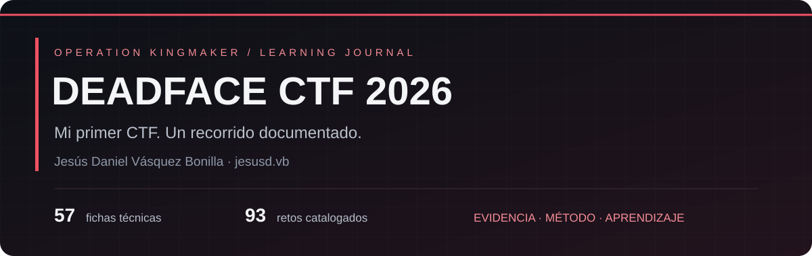
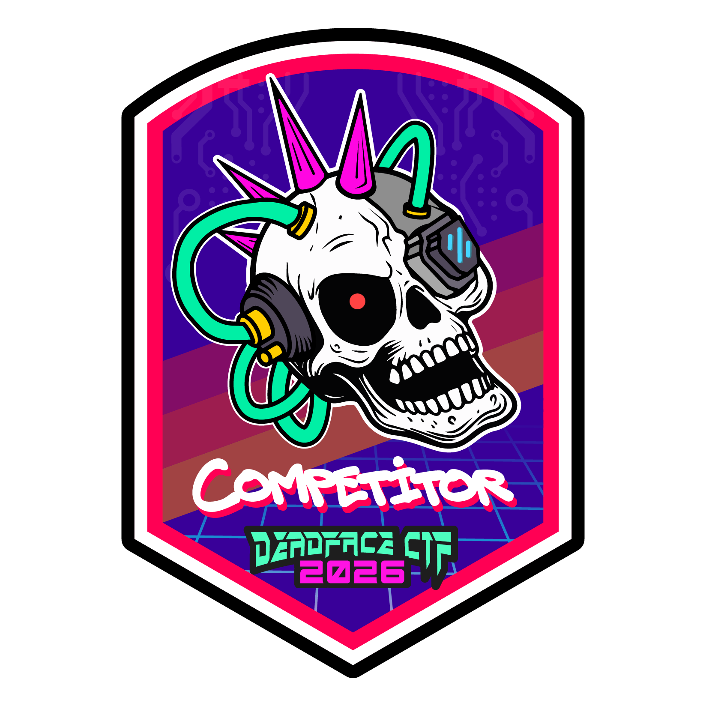
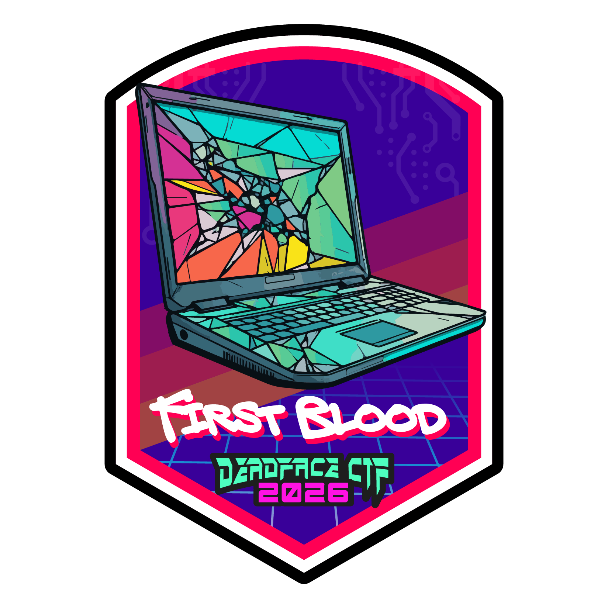

<p align="center"></p>

# DEADFACE CTF 2026 · Mi primer CTF

Soy **Jesús Daniel Vásquez Bonilla**, estudiante de Seguridad Informática en el ITLA. Participé individualmente con el alias **jesusd.vb**. Este repositorio reúne mis procedimientos, resultados y aprendizajes de **Operation Kingmaker**, con especial interés en análisis de incidentes, tráfico de red y evidencia digital.

Mi objetivo al participar fue aprender. Aquí documento tanto los hallazgos que pude comprobar como los casos donde todavía falta evidencia para reproducir todo el recorrido.

**[Leer la bitácora en PDF](docs/bitacora-tecnica.pdf)** · **[Certificado de participación](docs/certificado-deadface-2026.pdf)** · **[Explorar los writeups](writeups/README.md)** · **[Ver el catálogo](catalogo/README.md)** · **[Método de trabajo](docs/metodologia.md)** · **[Ejemplos ejecutables](scripts/README.md)**

## Resultado de mi primer CTF

**Puesto 173 de 1,072 equipos en el marcador · 5,666 puntos · participación individual como R00tless / jesusd.vb.**

La plataforma oficial registra **64 entradas aceptadas**: 62 fuera de Miscellaneous, más Starter y AI Rule. [Ver clasificación, capturas, desglose y lista completa](docs/resultados-oficiales.md).

## Insignias y certificados

<p align="center"> </p>

| Reconocimiento de Cyber Hacktics | Certificado | Verificación |
| --- | --- | --- |
| **DEADFACE CTF 2026 Competitor** — participación activa | [PDF original](docs/certificado-deadface-2026.pdf) | [Credforge](https://credforge.app/credentials/911f73ca-13a2-4a86-b9d8-fb988eb32354) |
| **DEADFACE CTF 2026 First Blood** — Exfiltration, 17 de octubre de 2026 | [PDF original](docs/certificado-first-blood-exfiltration.pdf) | [Credforge](https://credforge.app/credentials/41ef1b54-69ac-4135-a6b7-ae6b6fa1a3e9) |

[Detalle del First Blood y verificación consultada](docs/first-blood-exfiltration.md) · [Writeup de Exfiltration](writeups/steganography/exfiltration.md)

## Qué encontrarás

| Contenido | Alcance |
| --- | --- |
| **57 fichas técnicas** | 13 categorías con resultados recuperados |
| **93 retos catalogados** | 18 categorías, puntos y estado de evidencia |
| **14 fichas verificadas** | Comprobaciones o aceptación registradas en la bitácora |
| **23 fichas documentadas** | Resultado y recorrido conservados, sin repetir toda la cadena |
| **20 fichas parciales** | Resultado histórico con entradas o pasos pendientes |

Las 57 fichas **no equivalen a 57 retos aceptados oficialmente**. La clasificación refleja la evidencia de la bitácora, editada el 19 de octubre de 2026. La [comprobación posterior en la plataforma oficial](docs/resultados-oficiales.md) se documenta por separado de esos estados históricos.

## Por dónde empezar

| Caso | Qué permite estudiar |
| --- | --- |
| [Name to a Face](writeups/de-monne-breach/name-to-a-face.md) | Atribución de usuario y estación desde NTLMSSP |
| [Hidden in Plain Task](writeups/de-monne-breach/hidden-in-plain-task.md) | Rastros de persistencia en memoria y tareas programadas |
| [Twilight Zone Transfer](writeups/traffic-analysis/twilight-zone-transfer.md) | Identificación pasiva de AXFR en una captura DNS |
| [Second Shift](writeups/cryptography/second-shift.md) | Recuperación de texto por reutilización del flujo CTR |
| [Info Leaks](writeups/aurora-patient-zero/info-leaks.md) | Inspección de configuración y Base64 en un paquete iOS |
| [Art Heist: The Forgery](writeups/forensics/art-heist-the-forgery.md) | Comparación de imágenes y lectura de metadatos XMP |

## Áreas de práctica

**Análisis de tráfico y protocolos:** NTLMSSP, SMB, LLMNR, DNS, HTTP e ICMP; reconstrucción documentada de TLS, SIP y SRTP.

**Informática forense:** metadatos de imágenes, cadenas de memoria, artefactos de navegador y correlación de indicadores.

**Criptografía y análisis estático:** ROT13, XOR, reutilización de flujo, contenedores IPA/APK, SQLite y lectura de binarios.

Cada ficha desarrolla el objetivo, las herramientas, el procedimiento, el resultado conservado y el aprendizaje. Los fragmentos incompletos se identifican como tales.

## Documentación

- [Cómo interpreto la evidencia y los estados](docs/metodologia.md)
- [Herramientas y su uso documentado](docs/herramientas.md)
- [Participación y reflexión](docs/participacion.md)
- [Procedencia, límites y materiales](docs/procedencia.md)
- [Intentos y candidatos pendientes](docs/pendientes.md)
- [Inventario de hashes de referencia](evidencias/README.md)
- [Créditos y derechos](CREDITOS.md)

## Reproducir los ejemplos locales

Se requiere **Python 3.10 o posterior**. Los dos ejemplos autocontenidos usan la biblioteca estándar y no necesitan conexión de red:

```bash
python scripts/hail_caesar.py
python scripts/x_marks_the_spot.py
```

Estos dos ejemplos son reconstrucciones didácticas preparadas para esta publicación. También se incluyen [diez scripts históricos](scripts/originales/README.md), conservados sin cambios, y la configuración necesaria para reproducir Keypad Oracle. Los volcados, ejecutables y respaldos completos no se distribuyen en el repositorio.

## Lo que me dejó esta experiencia

Una bandera aislada no conserva el aprendizaje. Necesito guardar las entradas, los comandos, los resultados y la razón por la que considero válido un hallazgo. También aprendí a comenzar con lo básico: leer metadatos, revisar una cabecera o distinguir el usuario del nombre de una estación puede ser más útil que cambiar de herramienta.

## English overview

Personal learning portfolio from my first DEADFACE CTF, entered solo as **jesusd.vb**. It contains **57 technical writeups** and a **93-challenge catalog**, with explicit evidence states and reproducibility limits. Official results checked on October 26: **173rd of 1,072 ranked teams**, **5,666 points**, and **64 accepted entries** (including Starter and AI Rule), plus **First Blood for Exfiltration**. Documentation is in Spanish; historical writeup evidence states remain separate from accepted-solve records.

---

**Autor:** [Jesús Daniel Vásquez Bonilla · DNLVZ](https://github.com/DNLVZ)  
Documentación personal de aprendizaje. DEADFACE CTF y los materiales de los retos pertenecen a sus respectivos autores.
