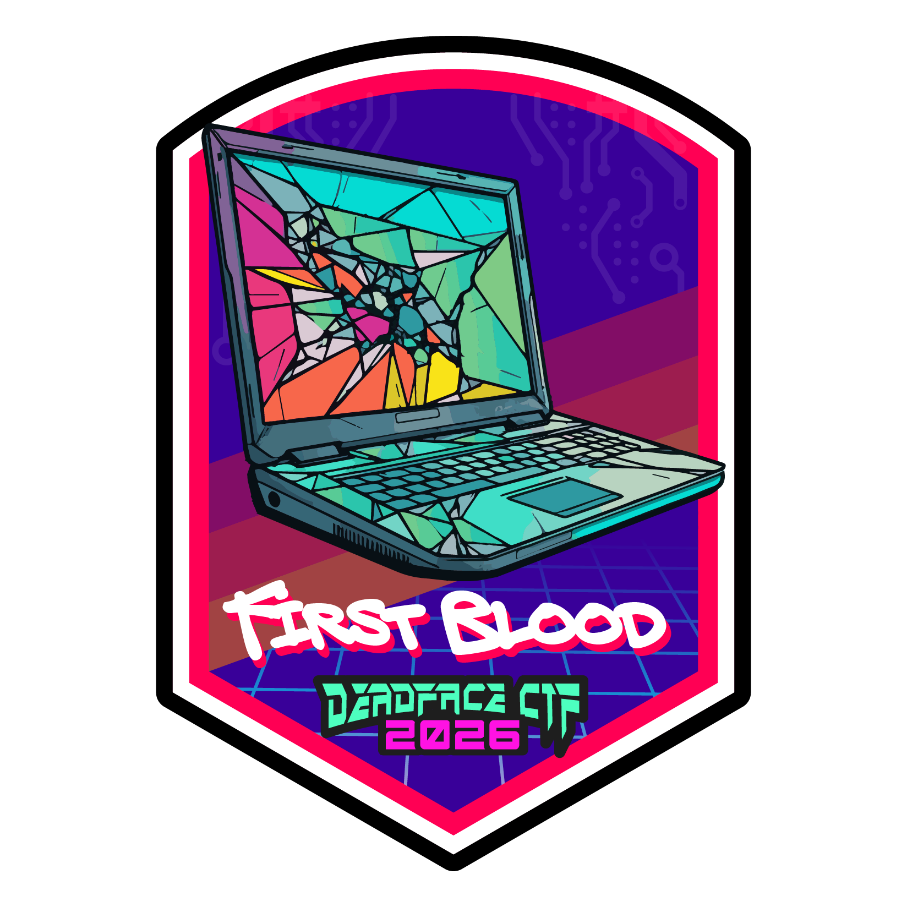

# First Blood — Exfiltration

[Inicio](../README.md) · [Writeup de Exfiltration](../writeups/steganography/exfiltration.md)

Cyber Hacktics otorgó la credencial **DEADFACE CTF 2026 First Blood** a **jesusd.vb (R00tless): Exfiltration**. El criterio reconoce al primer competidor o equipo en enviar la bandera correcta de un reto elegible, según la plataforma oficial de puntuación. Este reconocimiento corresponde a **Exfiltration**, de Steganography; no representa el primer puesto general del evento.

**[Certificado original en PDF](certificado-first-blood-exfiltration.pdf)** · **[Verificar credencial en Credforge](https://credforge.app/credentials/41ef1b54-69ac-4135-a6b7-ae6b6fa1a3e9)**

| Dato | Referencia |
| --- | --- |
| Emisor | Cyber Hacktics |
| Identificación en la credencial | jesusd.vb (R00tless): Exfiltration |
| Fecha del reconocimiento | 17 de octubre de 2026 |
| Notificación por correo | 25 de octubre de 2026 |
| Consulta y actualización del portafolio | 26 de octubre de 2026 |

## Verificación consultada

Al consultar la página canónica de Credforge el 26 de octubre de 2026, mostró estado **Valid** y comprobaciones satisfactorias de formato Open Badges 3, firma, revocación y fechas. La página indicaba comprobación de la lista de revocación a las `2026-10-26T16:55:50Z` y validez inicial `2026-10-17T00:00:00Z`. Esta descripción registra lo mostrado por Credforge; no equivale a una verificación criptográfica local independiente.

## Relación con la bitácora

Esta evidencia oficial se incorpora como actualización posterior a la bitácora del 19 de octubre. La ficha de Exfiltration conserva el estado **Documentado**, que describe la evidencia del procedimiento y su reproducibilidad. La distinción acredita por separado el First Blood; los recuentos históricos de fichas no cambian.

El certificado y la insignia se conservan sin modificar. Sus hashes calculados se encuentran en el [inventario de evidencia](../evidencias/README.md). Se publica únicamente el enlace canónico de verificación.
