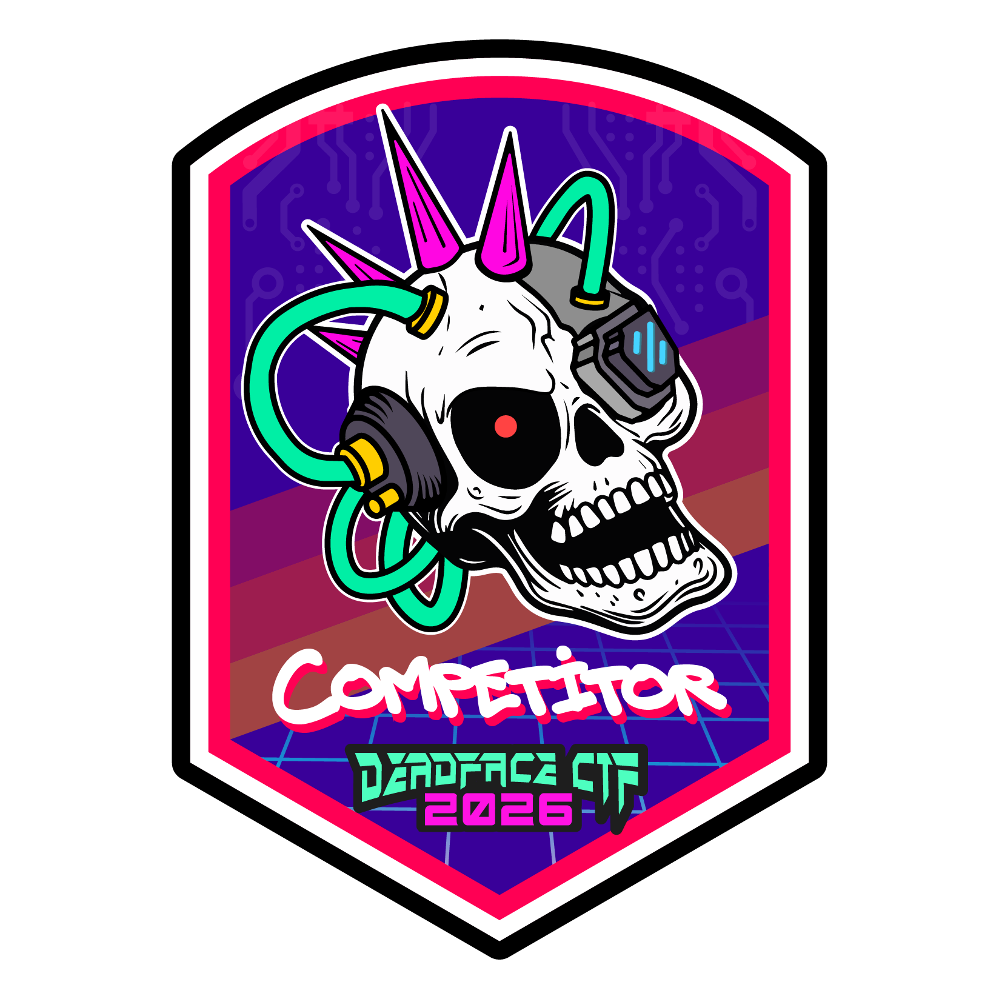

# Participación y aprendizajes

[Inicio](../README.md)

Participé individualmente en DEADFACE CTF 2026 con el alias **jesusd.vb**. Fue mi primer CTF. Mi objetivo principal fue aprender a investigar retos de áreas distintas y guardar un recorrido que pudiera explicar después.

La bitácora conserva la referencia a una credencial **DEADFACE CTF 2026 Competitor**, emitida por Cyber Hacktics, con fecha inicial del 18 de octubre de 2026. Su criterio es la participación activa; no certifica una cantidad específica de soluciones ni una competencia profesional independiente. Se conservan la imagen original de la insignia y el [certificado individual en PDF](certificado-deadface-2026.pdf). El SHA-256 del certificado coincide con el inventario de la bitácora: `f6f965361be4db2df148da7874902ec41799f499b4310faf8699c28195f6cef2`.

[Consultar referencia de la credencial en Credforge](https://credforge.app/credentials/911f73ca-13a2-4a86-b9d8-fb988eb32354)

La publicación no incluye una nueva validación criptográfica de la credencial.

Al terminar relaté haber quedado dentro del top 200. La bitácora no contiene una captura del puesto exacto, el puntaje ni el total de equipos, por lo que este repositorio no utiliza esa referencia como una clasificación oficial verificada.

## Reconocimiento First Blood

Cyber Hacktics también me otorgó **DEADFACE CTF 2026 First Blood** por **Exfiltration**, con fecha del 17 de octubre de 2026. El correo de notificación llegó el 25 de octubre. La credencial identifica al destinatario como **jesusd.vb (R00tless): Exfiltration** y reconoce la primera resolución del reto por un competidor o equipo, según la plataforma oficial.

El [detalle del reconocimiento](first-blood-exfiltration.md) incluye el certificado original y la verificación consultada en Credforge. Esta distinción corresponde al reto; no establece una posición general del evento.

## Reflexión

Cambiar entre criptografía, capturas de red, imágenes, aplicaciones y sistemas me obligó a prestar atención a qué estaba buscando realmente. En varios casos, la diferencia estuvo en el campo correcto o en el orden de los fragmentos.

Documentar la experiencia también dejó claro qué debo mejorar: guardar las consultas completas, conservar las entradas y capturar las validaciones mientras todavía tengo el entorno disponible. Un caso parcial puede seguir siendo útil si explico con precisión qué se conoce y qué falta.

Fuente: bitácora técnica personal, páginas 2 y 75.
