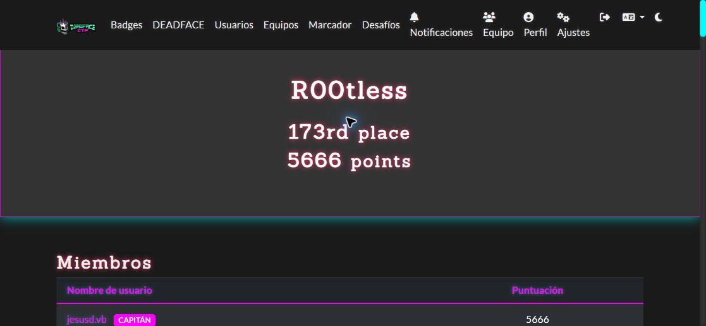
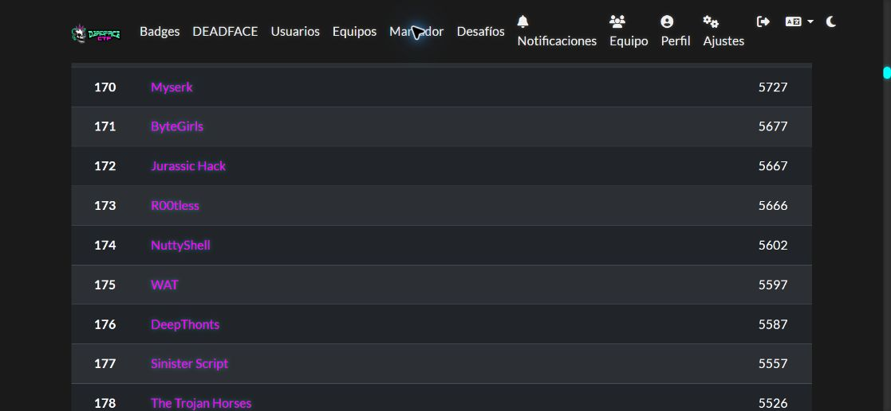

# Resultados oficiales — R00tless

[Inicio](../README.md) · [Participación e insignias](participacion.md)

Consulta de la plataforma oficial realizada el **26 de octubre de 2026**.

| Resultado | Dato comprobado |
| --- | --- |
| Equipo | R00tless |
| Clasificación | **173 de 1,072 equipos listados en el marcador** |
| Puntaje | **5,666 puntos** |
| Integrantes visibles | **1: jesusd.vb**, capitán; aporta los 5,666 puntos |
| Entradas aceptadas en «Solves» | **64** |
| Desglose | **62 fuera de Miscellaneous**, más Starter (1 punto) y AI Rule (0 puntos) |
| Categorías con aceptaciones | **15**, incluida Miscellaneous |
| Reconocimiento especial | **First Blood de Exfiltration** |

El puesto equivale aproximadamente al **16.1% superior del marcador**, cálculo propio `173 / 1072 × 100`. El denominador corresponde a los equipos clasificados que la página mostraba, con puestos consecutivos del 1 al 1,072 y al menos un punto; no se presenta como el número total de inscritos ni de personas.

## Fuentes y capturas

- [Marcador oficial](https://ctf.deadface.io/scoreboard): fila `173 — R00tless — 5666`.
- [Perfil público del equipo](https://ctf.deadface.io/teams/896): puesto, puntos, único miembro y resoluciones.
- [Perfil público de jesusd.vb](https://ctf.deadface.io/users/1874): las mismas 64 aceptaciones y 5,666 puntos.
- [Lista transcrita en CSV](../evidencias/resoluciones-oficiales.csv) y [resumen en JSON](../evidencias/resultados-oficiales.json).

## Aceptaciones por categoría

| Categoría | Entradas aceptadas | Puntos |
| --- | ---: | ---: |
| Traffic Analysis | 6 | 1,030 |
| De Monne Breach | 12 | 1,000 |
| Reverse Engineering | 5 | 965 |
| Cryptography | 7 | 500 |
| OSINT | 6 | 490 |
| Brain Scans | 4 | 390 |
| Mobile | 2 | 350 |
| Steganography | 6 | 285 |
| Database | 5 | 260 |
| Web | 1 | 200 |
| Aurora Patient Zero | 4 | 100 |
| Forensics | 2 | 50 |
| Bonus | 1 | 25 |
| De Monne Slayer | 1 | 20 |
| Miscellaneous | 2 | 1 |
| **Total** | **64** | **5,666** |

## Lista de aceptaciones

Las fechas y horas siguientes se conservan como aparecían en el navegador. La interfaz no indicaba aquí una zona horaria; no se convierten a otra. La suma de los valores coincide con el puntaje mostrado.

| Reto | Categoría | Puntos | Fecha y hora mostrada |
| --- | --- | ---: | --- |
| Speak Friend and Enter | Web | 200 | October 18th, 4:03:55 PM |
| [False Telemetry](../writeups/de-monne-breach/false-telemetry.md) | De Monne Breach | 250 | October 18th, 3:32:40 PM |
| [Challenge Accepted](../writeups/de-monne-breach/challenge-accepted.md) | De Monne Breach | 100 | October 18th, 3:31:23 PM |
| [Borrowed Script](../writeups/de-monne-breach/borrowed-script.md) | De Monne Breach | 100 | October 18th, 3:29:41 PM |
| [Back to Basics](../writeups/aurora-patient-zero/back-to-basics.md) | Aurora Patient Zero | 15 | October 18th, 3:24:08 PM |
| [SQL Skillz](../writeups/aurora-patient-zero/sql-skillz.md) | Aurora Patient Zero | 50 | October 18th, 3:23:12 PM |
| [Down the Rabbit Hole](../writeups/aurora-patient-zero/down-the-rabbit-hole.md) | Aurora Patient Zero | 10 | October 18th, 3:22:33 PM |
| [Info Leaks](../writeups/aurora-patient-zero/info-leaks.md) | Aurora Patient Zero | 25 | October 18th, 3:21:49 PM |
| DOOM | Bonus | 25 | October 18th, 3:03:17 PM |
| [Return to Sender](../writeups/traffic-analysis/return-to-sender.md) | Traffic Analysis | 80 | October 18th, 2:57:01 PM |
| [Twilight Zone Transfer](../writeups/traffic-analysis/twilight-zone-transfer.md) | Traffic Analysis | 50 | October 18th, 2:55:03 PM |
| [Cereal Killer 03](../writeups/reverse-engineering/cereal-killer-03.md) | Reverse Engineering | 500 | October 18th, 2:53:14 PM |
| [Cereal Killer 04](../writeups/reverse-engineering/cereal-killer-04.md) | Reverse Engineering | 250 | October 18th, 2:50:55 PM |
| Keep Digging | Steganography | 100 | October 18th, 2:43:14 PM |
| [Second Shift](../writeups/cryptography/second-shift.md) | Cryptography | 90 | October 18th, 2:40:11 PM |
| [Digital Design](../writeups/cryptography/digital-design.md) | Cryptography | 100 | October 18th, 2:37:38 PM |
| [Chess Key](../writeups/cryptography/chess-key.md) | Cryptography | 200 | October 18th, 2:32:54 PM |
| [X Marks the Spot](../writeups/cryptography/x-marks-the-spot.md) | Cryptography | 30 | October 18th, 2:05:13 PM |
| [Factory Settings](../writeups/brain-scans/factory-settings.md) | Brain Scans | 25 | October 18th, 1:11:44 AM |
| [Cache Money](../writeups/de-monne-breach/cache-money.md) | De Monne Breach | 150 | October 18th, 1:01:41 AM |
| [Public Offering](../writeups/de-monne-breach/public-offering.md) | De Monne Breach | 75 | October 18th, 1:01:12 AM |
| [Crown Jewels](../writeups/de-monne-breach/crown-jewels.md) | De Monne Breach | 75 | October 18th, 1:00:34 AM |
| [Hidden in Plain Task](../writeups/de-monne-breach/hidden-in-plain-task.md) | De Monne Breach | 75 | October 18th, 12:56:57 AM |
| [The Typo That Bit](../writeups/de-monne-breach/the-typo-that-bit.md) | De Monne Breach | 75 | October 18th, 12:46:09 AM |
| [The Workstation in the Middle](../writeups/de-monne-breach/the-workstation-in-the-middle.md) | De Monne Breach | 40 | October 18th, 12:45:43 AM |
| [Name to a Face](../writeups/de-monne-breach/name-to-a-face.md) | De Monne Breach | 10 | October 18th, 12:45:14 AM |
| [Uninvited Guest](../writeups/de-monne-breach/uninvited-guest.md) | De Monne Breach | 25 | October 18th, 12:44:27 AM |
| [You Wouldn't Git It](../writeups/osint/you-wouldn-t-git-it.md) | OSINT | 125 | October 17th, 8:07:36 PM |
| [A Pirate's Life for Me: Part 1](../writeups/traffic-analysis/a-pirate-s-life-for-me-part-1.md) | Traffic Analysis | 25 | October 17th, 7:46:31 PM |
| [Hooked](../writeups/forensics/hooked.md) | Forensics | 25 | October 17th, 7:28:14 PM |
| [It But A Wee Bit Reverse](../writeups/reverse-engineering/it-but-a-wee-bit-reverse.md) | Reverse Engineering | 15 | October 17th, 7:25:33 PM |
| [Hard Kept Secrets](../writeups/de-monne-slayer/hard-kept-secrets.md) | De Monne Slayer | 20 | October 17th, 7:15:27 PM |
| [Second Opinion](../writeups/brain-scans/second-opinion.md) | Brain Scans | 50 | October 17th, 6:40:14 PM |
| [Bedside Manner](../writeups/brain-scans/bedside-manner.md) | Brain Scans | 15 | October 17th, 6:37:27 PM |
| [The Original Reading](../writeups/database/the-original-reading.md) | Database | 70 | October 17th, 6:31:44 PM |
| File Dump 01 | Steganography | 10 | October 17th, 6:28:31 PM |
| [DECODE-DLE](../writeups/cryptography/decode-dle.md) | Cryptography | 25 | October 17th, 6:23:47 PM |
| [Cereal Killer 02](../writeups/reverse-engineering/cereal-killer-02.md) | Reverse Engineering | 150 | October 17th, 6:22:11 PM |
| [Cereal Killer 01](../writeups/reverse-engineering/cereal-killer-01.md) | Reverse Engineering | 50 | October 17th, 6:20:42 PM |
| [Heavy Hand](../writeups/database/heavy-hand.md) | Database | 100 | October 17th, 6:16:24 PM |
| [The Vibes Are Freaking Me Out](../writeups/osint/the-vibes-are-freaking-me-out.md) | OSINT | 75 | October 17th, 6:14:35 PM |
| [Exfiltration](../writeups/steganography/exfiltration.md) | Steganography | 75 | October 17th, 6:01:52 PM |
| [Headshot](../writeups/steganography/headshot.md) | Steganography | 10 | October 17th, 4:24:12 PM |
| [Prying Eyes](../writeups/database/prying-eyes.md) | Database | 55 | October 17th, 3:55:56 PM |
| [Alice and Bob Would Like a Word](../writeups/osint/alice-and-bob-would-like-a-word.md) | OSINT | 75 | October 17th, 3:50:02 PM |
| [Ghost of Squares Past](../writeups/osint/ghost-of-squares-past.md) | OSINT | 150 | October 17th, 3:39:04 PM |
| Signals from the Skull | Brain Scans | 300 | October 17th, 3:32:29 PM |
| [Keypad Oracle](../writeups/mobile/keypad-oracle.md) | Mobile | 200 | October 17th, 3:29:23 PM |
| [Don't Leave Me Hanging](../writeups/traffic-analysis/don-t-leave-me-hanging.md) | Traffic Analysis | 500 | October 17th, 3:22:34 PM |
| Who Goes There? | De Monne Breach | 25 | October 17th, 3:10:19 PM |
| [Art Heist: The Forgery](../writeups/forensics/art-heist-the-forgery.md) | Forensics | 25 | October 17th, 1:44:11 PM |
| [Locked... or Not?](../writeups/mobile/locked-or-not.md) | Mobile | 150 | October 17th, 12:32:44 PM |
| Bad Guys Be Bad | Traffic Analysis | 350 | October 17th, 12:30:47 PM |
| [Data Go Brrrrr](../writeups/traffic-analysis/data-go-brrrrr.md) | Traffic Analysis | 25 | October 17th, 12:28:08 PM |
| [Car Crash](../writeups/osint/car-crash.md) | OSINT | 50 | October 17th, 12:26:22 PM |
| [Chatty Cathy](../writeups/osint/chatty-cathy.md) | OSINT | 15 | October 17th, 12:23:23 PM |
| [Schedule of Concern](../writeups/database/schedule-of-concern.md) | Database | 20 | October 17th, 12:16:57 PM |
| [Admitted Under Another Name](../writeups/database/admitted-under-another-name.md) | Database | 15 | October 17th, 12:09:51 PM |
| [Conduct Unbecoming](../writeups/steganography/conduct-unbecoming.md) | Steganography | 75 | October 17th, 12:00:52 PM |
| [Hidden Loot Box](../writeups/steganography/hidden-loot-box.md) | Steganography | 15 | October 17th, 11:56:37 AM |
| [Infrequent Emojis](../writeups/cryptography/infrequent-emojis.md) | Cryptography | 50 | October 17th, 11:51:42 AM |
| [Hail Caesar](../writeups/cryptography/hail-caesar.md) | Cryptography | 5 | October 17th, 11:39:43 AM |
| Starter | Miscellaneous | 1 | October 17th, 11:31:47 AM |
| AI Rule | Miscellaneous | 0 | October 17th, 11:30:19 AM |

## Relación con las 57 fichas históricas

Las **64 aceptaciones** son registros oficiales de la plataforma. Las **57 fichas** son documentación recuperada de la bitácora del 19 de octubre: los dos conjuntos no son equivalentes. Los estados Verificado, Documentado y Parcial describen la evidencia técnica conservada y la reproducibilidad, mientras que la lista oficial acredita la aceptación registrada. No se inventan procedimientos para las entradas que todavía no tienen writeup.

La bitácora original en PDF se conserva como documento histórico. Esta página incorpora la comprobación posterior del resultado y sustituye la antigua referencia sin verificar al «top 200».
