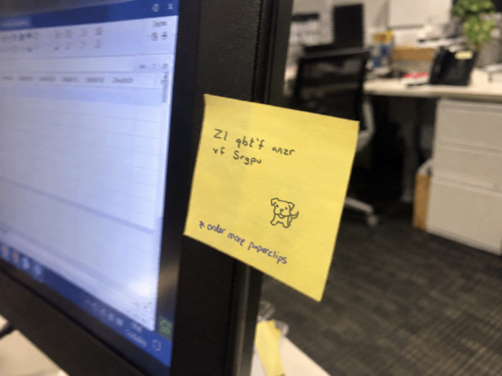

# Hail Caesar

[Índice de writeups](../README.md) · [Catálogo completo](../../catalogo/README.md)

**Categoría:** Cryptography · **Puntos en el catálogo:** 5 · **Estado:** Verificado

Descifrar la pista del nombre de un perro utilizando un desplazamiento César.
Evidencia: Aceptación registrada en la conversación

Herramientas: Lectura de imagen y Python codecs




## Procedimiento

1. Abrir pass_hint.png y transcribir cuidadosamente la nota: Zl qbt'f anzr vf Srgpu. La imagen y el enunciado
    relacionan el texto con el nombre del perro.

2. Observar que los espacios y el apóstrofo conservan posiciones naturales. Eso sugiere una sustitución de
    letras, no una reorganización del texto.

3. Probar ROT13, variante del cifrado César que desplaza cada letra trece lugares. Z se convierte en M; l en y;
     Srgpu en Fetch.

4. Leer el resultado completo: My dog's name is Fetch. La respuesta pedida es el nombre, no toda la oración.

5. Enviar deadface{Fetch}, respetando la mayúscula inicial. La conversación incluye confirmación del resultado
    por parte del participante.


## Comandos o lógica reproducible

```text
import codecs
message = "Zl qbt'f anzr vf Srgpu"
print(codecs.decode(message, "rot_13"))
# My dog's name is Fetch


```

## Resultado conservado

```text
deadface{Fetch}

```

## Por qué funciona

ROT13 es reversible con la misma operación: aplicar trece posiciones dos veces completa las veintiséis letras
del alfabeto.


## Aprendizaje para el análisis

Separar el método de descifrado del formato de entrega. Una solución correcta puede rechazarse si se incluye
texto adicional.

---

Fuente: bitácora técnica personal, edición del 19 de octubre de 2026, ficha 05, página 16. Adaptación a Markdown; no constituye una nueva ejecución ni una nueva aceptación en CTFd. Los datos técnicos pertenecen al escenario del CTF.
