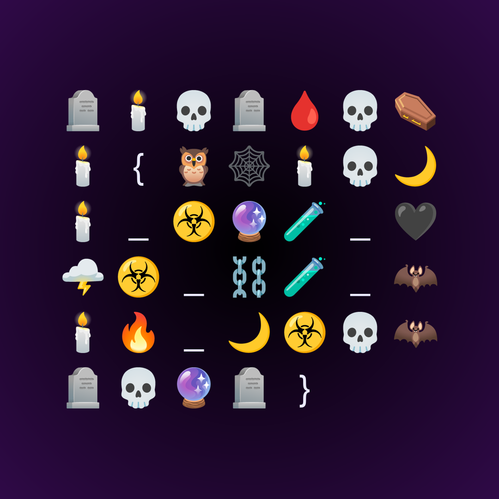

# Infrequent Emojis

[Índice de writeups](../README.md) · [Catálogo completo](../../catalogo/README.md)

**Categoría:** Cryptography · **Puntos en el catálogo:** 50 · **Estado:** Documentado

Interpretar un alfabeto de símbolos donde cada emoji representa una letra.
Evidencia: Aceptación registrada en la conversación

Herramientas: Lectura de imagen y tabla de sustitución




## Procedimiento

1. Conservar la imagen original y sus separadores. Tratar cada emoji completo como un símbolo; algunos
    contienen selectores de variación Unicode.

2. Usar las repeticiones y el prefijo esperado deadface para plantear correspondencias. Cada símbolo debe
    conservar el mismo valor en todas sus apariciones.

3. Construir la tabla de sustitución. Entre las correspondencias recuperadas figuran calavera=A, ataúd=C,
    lápida=D, vela=E, telaraña=L, murciélago=N, corazón negro=O y bola de cristal=R.

4. Sustituir todos los símbolos y conservar llaves y guiones bajos. El texto resultante es
    please_try_out_my_new_standard.

5. Revisar la consistencia de la tabla y el resultado completo. El participante respondió correcto en la
    conversación tras recibir esta bandera.


## Resultado conservado

```text
deadface{please_try_out_my_new_standard}

```

## Por qué funciona

Una sustitución monoalfabética preserva patrones de repetición. El prefijo del formato de bandera ofrece texto
conocido para iniciar la correspondencia.


## Aprendizaje para el análisis

La frecuencia ayuda, pero en mensajes cortos deben combinarse patrones, contexto y comprobación de todas
las posiciones.


## Alcance de la reconstrucción

El diccionario completo recuperado se incluye como material de referencia textual; una tabla de símbolos debe contrastarse con la
imagen original antes de automatizarla.

---

Fuente: bitácora técnica personal, edición del 19 de octubre de 2026, ficha 08, página 19. Adaptación a Markdown; no constituye una nueva ejecución ni una nueva aceptación en CTFd. Los datos técnicos pertenecen al escenario del CTF.
